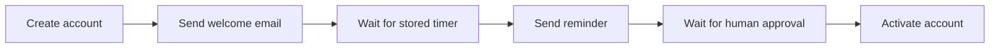

# AGEN

Persistent workflows for Django, Celery, and PostgreSQL.

AGEN stores workflow state, timers, human approvals, and dispatch intent in PostgreSQL.
Use it for sequential business processes that continue across worker or broker interruptions.

**Status:** Early `0.1.0` implementation with a Docker demo and database tests.
External side effects require idempotency. Recovery depends on the dispatcher and scheduled maintenance commands.

[Run the demo](#run-the-demo) · [Define a workflow](#how-it-works) · [Verification and limits](#verification-and-limits)

## The workflow



The included demo simulates external account and email operations with logs.
It uses a ten-second timer and a real persisted approval task.

## Why the database holds the state

A database write and a broker publish are separate operations.
A crash between them can leave a process without its next task.
AGEN writes the next dispatch intent to an outbox in the same transaction as the step result.
A dispatcher publishes that intent. Stored timers and recovery commands handle additional interruption paths.

## How It Works

Every workflow is a Python class. Each step is a method. Steps return the name of the next step, or `None` when the workflow is done.

```python
from agen import BaseWorkflow, RetryPolicy, WaitTimer, WaitHuman
from agen.registry import register

@register
class UserOnboarding(BaseWorkflow):
    retry_policy = {
        "activate": RetryPolicy(max_attempts=3, retryable_exceptions=(ActivationError,))
    }

    def step_start(self):
        self.state["account_id"] = create_account(self.state["user_id"])
        return "send_email"

    def step_send_email(self):
        send_welcome_email(self.state["account_id"])
        raise WaitTimer(hours=48, then_step="remind")

    def step_remind(self):
        send_reminder(self.state["user_id"])
        raise WaitHuman(title="Approve profile", assigned_role="manager", then_step="activate")

    def step_activate(self):
        activate_account(self.state["account_id"])
        return None
```

Agen handles the rest:

- Each step runs in a Celery task with `acks_late`.
- After every step, the next step is written to a transactional outbox in the same DB transaction. The step result and the dispatch are atomic.
- A long-running dispatcher process listens for PostgreSQL `NOTIFY` and publishes Celery tasks. A sweeper runs every 30 seconds as a fallback.
- Timers are stored in PostgreSQL — they survive broker restarts.
- Business retries are stored in PostgreSQL. Each retry attempt is claimed atomically before execution, preventing duplicate runs.
- A stalled-workflow monitor detects and re-enqueues workflows that go quiet after a configurable grace period.
- Committed step attempts are logged in `StepExecution`. Retried failures have the audit limitation documented below.

---

## Requirements

- Python 3.10+
- Django 4.2+
- Celery 5.3+
- PostgreSQL 14+
- Redis (for Celery broker)

---

## Run the demo

Requirements: Docker with Compose, and available local ports `5433`, `6380`, and `8001`.

```bash
git clone https://github.com/alimoradi296/AGEN.git
cd AGEN
docker compose -p agen-demo up -d --build
docker compose -p agen-demo exec web python manage.py migrate
docker compose -p agen-demo exec web python manage.py createsuperuser
docker compose -p agen-demo exec web python manage.py start_onboarding --user-id alice
```

Open [the demo dashboard](http://localhost:8001/).
The workflow initially waits at a stored timer.
After ten seconds, run:

```bash
docker compose -p agen-demo exec web python manage.py agen_tick
```

Open [Django admin](http://localhost:8001/admin/) with the account you created.
Open **Agen → Human tasks** and select the pending task.
Editing the task status alone does not resume the workflow. Resolve it through the shell with its actual ID:

```bash
docker compose -p agen-demo exec web python manage.py shell
```

```python
from agen.human import resolve_human_task
resolve_human_task(task_id=1, approved=True, resolved_by="demo")
```

Replace `1` with the pending task ID. The workflow then reaches `completed`.
The dashboard shows each stored instance and its current state.

The Compose file includes a dispatcher and Celery Beat.
For manual maintenance, use `agen_tick`, `agen_sweep`, `agen_process_retries`, and `agen_recover_stalled`.

Stop the demo services:

```bash
docker compose -p agen-demo down
```

This command retains the demo database volumes.
The demo uses development credentials and settings. Configure separate credentials and settings for deployment.

---

## Installing in Your Project

Install the library from a source checkout:

```bash
python -m venv .venv
source .venv/bin/activate
python -m pip install -e .
```

Add `agen` to `INSTALLED_APPS`:

```python
INSTALLED_APPS = [
    ...
    "agen",
]
```

Set the database alias (optional, defaults to `"default"`):

```python
AGEN_DB_ALIAS = "default"
```

Initialize the Celery app in your project's `__init__.py`:

```python
# myproject/__init__.py
from myproject.celery import app as celery_app
__all__ = ("celery_app",)
```

Add `agen` to Celery's autodiscover list or call `app.autodiscover_tasks(['agen'])`.

Run migrations:

```bash
python manage.py migrate
```

---

## Defining Workflows

### Steps

A step method starts with `step_`. It receives no arguments. It reads and writes `self.state` (a plain dict, persisted as JSON). It returns the name of the next step (string) or `None` to complete the workflow.

```python
def step_my_step(self):
    result = call_something(self.state["input"])
    self.state["result"] = result
    return "next_step"
```

### Waiting for a Timer

```python
def step_send_invoice(self):
    send_invoice(self.state["order_id"])
    raise WaitTimer(hours=72, then_step="send_reminder")
```

### Waiting for Human Approval

```python
def step_needs_review(self):
    raise WaitHuman(
        title="Approve the refund",
        assigned_role="finance",
        then_step="process_refund",
    )
```

Resolve it from anywhere:

```python
from agen.human import resolve_human_task
resolve_human_task(task_id=42, approved=True, resolved_by="jane")
```

### Retry Policies

```python
class MyWorkflow(BaseWorkflow):
    retry_policy = {
        "call_api": RetryPolicy(
            max_attempts=5,
            initial_delay=1.0,
            backoff_factor=2.0,
            max_delay=60.0,
            retryable_exceptions=(RequestTimeout, ServiceUnavailable),
        )
    }

    def step_call_api(self):
        data = external_api.get(self.state["resource_id"])
        self.state["data"] = data
        return "process"
```

If `call_api` raises `RequestTimeout` or `ServiceUnavailable`, Agen creates a `RetryInstruction` in the database and retries with exponential backoff. Up to 5 attempts total. The final failure is recorded and the workflow transitions to `failed`.

### Infrastructure Errors

Transient DB errors (`OperationalError`, `InterfaceError`) are automatically detected and trigger Celery-level retries (up to 10 times with jitter). No `RetryInstruction` is created. Configure additional types:

```python
class MyWorkflow(BaseWorkflow):
    infrastructure_exceptions = (psycopg2.OperationalError, redis.ConnectionError)
```

### Long-Running Steps

If a step takes longer than 5 minutes, increase the grace period to prevent false stalled-recovery:

```python
class MyWorkflow(BaseWorkflow):
    stalled_grace_period = timedelta(minutes=30)
```

---

## Starting a Workflow

```python
from agen.models import OutboxMessage, WorkflowInstance
from agen.engine import _notify_outbox
from django.db import transaction

with transaction.atomic():
    instance = WorkflowInstance.objects.create(
        workflow_name="UserOnboarding",
        status="running",
        current_step="start",
        state={"user_id": user.id},
    )
    OutboxMessage.objects.create(instance=instance, step_name="start")
    _notify_outbox()
```

---

## Observability

### Django Signals

```python
from django.dispatch import receiver
from agen.signals import workflow_completed, workflow_failed, workflow_step_failed

@receiver(workflow_completed)
def on_completed(sender, instance, **kwargs):
    notify_user(instance.state["user_id"], "Your workflow is done.")

@receiver(workflow_failed)
def on_failed(sender, instance, **kwargs):
    alert_ops(instance.id, instance.workflow_name)
```

### List Stuck Workflows

```bash
python manage.py agen_list_stuck --minutes 10
```

### Django Admin

All models are registered. You can browse `WorkflowInstance`, `StepExecution`, `HumanTask`, `RetryInstruction`, `Timer`, and `OutboxMessage` from the admin.

---

## Production Deployment

Recommended Docker Compose services:

| Service | Command | Notes |
|---|---|---|
| `db` | PostgreSQL 14+ | Required |
| `redis` | Redis 7 with `appendonly yes` | Required |
| `web` | Django + gunicorn | Required |
| `worker` | `celery -A myproject worker` | Required |
| `dispatcher` | `python manage.py agen_dispatcher` | Required — `restart: unless-stopped` |
| `beat` | `celery -A myproject beat` | Optional — see cron alternative |

### Redis Persistence

Redis must be configured for persistence. Without it, task messages are lost on restart. Agen's database-backed mechanisms recover from this, but there will be latency.

```
--appendonly yes --save 900 1 --save 300 10
```

### Cron Alternative to Celery Beat

```
* * * * * cd /app && python manage.py agen_sweep
* * * * * cd /app && python manage.py agen_tick
* * * * * cd /app && python manage.py agen_process_retries
* * * * * cd /app && python manage.py agen_recover_stalled
0 2 * * * cd /app && python manage.py agen_cleanup
```

### Dispatcher Health

The dispatcher logs a heartbeat every 30 seconds:

```
INFO agen_dispatcher heartbeat — alive
```

Alert if this stops appearing. The sweeper (`agen_sweep`) continues to function as a fallback while the dispatcher is down, with up to 30 seconds of added latency.

---

## Testing

### Functional Tests (No Celery Required)

```python
from agen.testing import run_workflow_sync

def test_onboarding(db):
    instance = run_workflow_sync("UserOnboarding", {"user_id": 1})
    # If the workflow suspends (WaitTimer/WaitHuman), the signal is raised.
    # Use pytest.raises to assert on it.
```

Run the test suite:

```bash
python -m pytest tests/functional/ -v
```

### Mock Steps

```python
def test_with_mock_api(db):
    def mock_call_api(workflow):
        workflow.state["data"] = {"id": 1}
        return "process"

    instance = run_workflow_sync(
        "MyWorkflow",
        {"resource_id": 99},
        mock_steps={"call_api": mock_call_api},
    )
    assert instance.status == "completed"
```

---

## Data Model Summary

| Table | Purpose |
|---|---|
| `agen_workflowinstance` | One row per workflow run. Status, current step, state JSON. |
| `agen_stepexecution` | One row per step attempt (final attempts only for retried steps). |
| `agen_outboxmessage` | Pending dispatches. Drained by dispatcher + sweeper. |
| `agen_retryinstruction` | Pending business retries. Claimed atomically before execution. |
| `agen_timer` | Pending timer suspensions. Processed by `agen_tick`. |
| `agen_humantask` | Pending human approvals. Resolved via `resolve_human_task()`. |

---

## Verification and limits

The repository contains [functional tests](tests/functional/test_workflow_sync.py) and [database integration tests](tests/integration/test_engine.py).
They cover step transitions, outbox records, timer processing, human approval, retries, and stalled recovery.
The integration tests invoke execution directly. They do not prove live worker crash recovery across every interruption point.

Recovery requires PostgreSQL data, available workers, the dispatcher, and scheduled maintenance commands.
A transaction cannot make an external API call exactly once. Use idempotency keys or another deduplication mechanism for external effects.
Tune the stalled grace period for your longest step.

### Known limitations

**Incomplete audit trail for retried steps:** A scheduled business retry rolls back the failed attempt and its `StepExecution` record. Intermediate failure details are in `RetryInstruction.error`. Only the final attempt (success or final failure) produces a committed `StepExecution` row. This is ADR-004; the fix is planned for Roadmap Phase 4.

**Stalled recovery resets retry count:** If a worker crashes after claiming a `RetryInstruction` but before executing the step, that attempt is lost. The stalled-recovery monitor will eventually re-enqueue the step from attempt 1, potentially exceeding `max_attempts` across recovery cycles. Design steps to be idempotent.

**No parallel steps:** Workflows execute sequentially. User-managed parallelism via Celery groups is outside scope.

---

## Contributing

See [CONTRIBUTING.md](CONTRIBUTING.md) for setup instructions, code style, and how to submit a PR.

---

## Changelog

See [CHANGELOG.md](CHANGELOG.md) for release history.

---

## License

MIT
